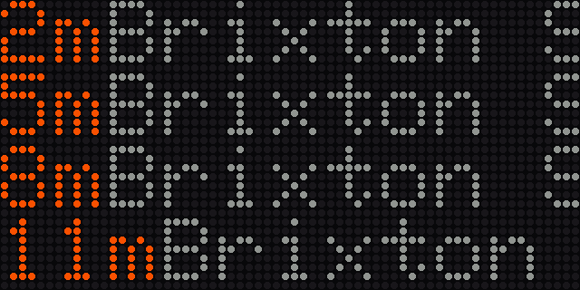
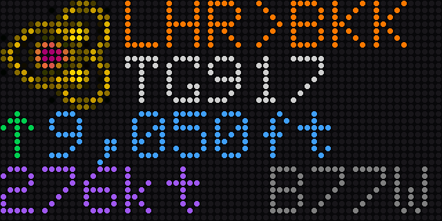
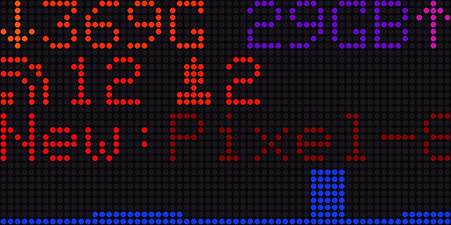

# Glowing Square

A purpose-built display: a 64×32 LED matrix and an ESP32 in a wooden frame,
showing one of three things:

- **Tube / London Bus**: the next departures from your stop, from TfL.
- **Flights**: the plane overhead right now, with its route, altitude and speed.
- **Unifi**: your home network: monthly traffic, clients and guests, new
  arrivals, and a graph of the last five hours.


Full photo album [here](https://imgur.com/a/xTvUx8F).

| Tube | Flights | Unifi |
|---|---|---|
|  |  |  |

<sub>Rendered by `test/test_render.py` from real TfL and adsb.lol answers.</sub>

**Glowing Square 2** is one firmware for all three: you pick the mode in the
web interface, and each mode keeps the layout it had as its own sketch in 2020.
The v1 sketches are kept under the [`v1-legacy`](../../tree/v1-legacy) tag.

## What's new in 2

- **One firmware, mode chosen in the browser.** No recompiling for a different
  display.
- **Web interface.** A status page with a live view of the matrix, a Settings
  page for every option, firmware updates, logs, and a password if you want one.
- **Install from the browser.** The [web flasher](https://alfo.github.io/GlowingSquare/)
  flashes the firmware over USB and hands the device your WiFi. After that,
  updates arrive over the air from GitHub Releases.
- **No more PHP.** Unifi mode talks to your console directly, with an API key.
- **Flights from open data.** [adsb.lol](https://adsb.lol) and
  [adsbdb](https://www.adsbdb.com) replace the unofficial Flightradar24 feed.
- **Home Assistant.** MQTT discovery adds a light (on/off, brightness) and
  selects for the mode and party mode. v1's topics still work.
- **Smooth.** Scrolling text no longer freezes everything else; the device
  answers the web, MQTT and the network while it scrolls.

## Hardware

* 64×32 P4 LED matrix (HUB75)
* An ESP32: the original builds use a **D1 Mini 32** on **Brian Lough's ESP32
  Matrix Shield (Mini 32)**
* 24V PSU (up to 35W per display) and an LM2596 buck converter to 5V, or a
  5V supply
* Two-core cable, Wago or screw connectors
* 6× M3 12mm bolts, 16× 3mm short countersunk screws

A 5V supply works too, but the 100W+ ones tend to have loud fans; a 24V 120W
PSU is silent and copes better with long cable runs.

### Which firmware build?

| Build | For |
|---|---|
| D1 Mini 32 + Brian Lough Matrix Shield | The original displays. That shield wires one colour line, so it uses the PxMatrix driver. |
| ESP32 + HUB75 (DMA) | A classic ESP32 with all six colour lines wired: Brian Lough's I2S Matrix Shield, the ESP32 Trinity, or hand-wired to the default pins. Smoother, no flicker. |
| ESP32-S3 + HUB75 (DMA) | Any ESP32-S3 with 8 MB flash. Pins are set on the Settings page. |

## Enclosure

The `Enclosure` folder has the STLs of the 3D-printed parts and the full
Fusion 360 model showing how it all fits together and what wood is needed.


## Setting up

1. Open the [web flasher](https://alfo.github.io/GlowingSquare/) in Chrome or
   Edge, pick your build, connect the board over USB and click **Install**.
   Enter your WiFi when it asks.
2. Or skip that: the matrix shows a setup WiFi network and its password. Join
   it from your phone and pick your network on the page that opens.
3. Open the address the device shows (or `http://glowingsquare.local/`), go to
   **Settings**, choose a mode and fill in its section.

**Flashing over USB with the panel connected** (Mini 32 shield): the panel's
OE line sits on GPIO2, one of the pins the ESP32 reads at reset, and a powered
panel holds it high, so the board refuses to enter download mode ("Wrong boot
mode detected"). Unplug the ribbon to the panel while flashing, then plug it
back in. Updates after the first install come over WiFi and avoid this.

The D1 Mini 32's USB chip is a CP2104, which macOS supports out of the box;
no driver is needed.

To move the device to another network later, hold **BOOT** for three seconds,
or use **Network → Change network**.

### Tube / London Bus

Find your stop's id with `https://api.tfl.gov.uk/StopPoint/Search/<name>`
(`940GZZLUOXC` is Oxford Circus). TfL treats tube and bus stops alike.

- **Line or route**: `victoria`, `northern`, `H91`, `9`. Leave it empty for
  every line at the stop.
- **Direction**: inbound, outbound or both.
- **App key**: optional. TfL limits anonymous requests heavily; a free key from
  [api-portal.tfl.gov.uk](https://api-portal.tfl.gov.uk) avoids that.

### Flights

The latitude and longitude of the middle of the area to watch, and a radius in
nautical miles. Coming from v1's `lat1,lat2,lon1,lon2` box? The Flights
section has a converter.

### Unifi

The console's address (`https://192.168.1.1`), the site (usually `default`),
and either:
- an **API key** (UniFi OS: *Network → Settings → Control Plane → Integrations*), or
- a **local user and password**, for a UniFi OS console or a classic controller.

The graph is the controller's own 5-minute history, so it is full from the
first update.

## MQTT and Home Assistant

Set the broker, port, user and password, and the room, on the Settings page.
v1's topics are unchanged:

- `<room>/<name>/mqtt`: `connected` / `disconnected` (retained, last will)
- `<room>/<name>/in`: `{"brightness": 160}` fades to that brightness
- `<room>/state`: `{"party": "chill"}`, `"on"` or `"off"`

`<name>` is `glowingsquare/tube`, `glowingsquare/flight` or
`glowingsquare/unifi` for the active mode, unless you set a device topic.

With **Home Assistant discovery** on, the display appears in Home Assistant
by itself: a light (on/off and brightness), selects for the mode and party
mode, its WiFi signal and its firmware version.

## Building it yourself

```bash
pio run -e gs-mini32-pxmatrix      # or gs-esp32-dma, gs-s3-dma
scripts/check.sh                   # house rules, page scripts, sizes
python3 test/test_render.py        # the modes against recorded API answers
```

`python3 test/test_render.py --png out/` also writes a picture of each mode
as the matrix would show it.

The firmware is built on Flat Field's esp32-iot-template:
`src/app`, `src/services`, `src/web` and `src/hardware` are its core, and
`tools/sync_template.py` brings in its fixes (`.template-version` records
which commit). Glowing Square itself lives in
`src/project/`. See [AGENTS.md](AGENTS.md) for how the code is organised.

## Licence

GPL-3.0 (see [LICENSE](LICENSE) and [NOTICE.md](NOTICE.md)): the core comes
from SpoolmanScale by Niko11111. The party-mode patterns are from
[Aurora](https://github.com/pixelmatix/aurora) by Jason Coon (MIT), and
`lib/PxMatrix` is [PxMatrix](https://github.com/2dom/PxMatrix) by Dominic
Buchstaller (BSD), with fixes for Arduino core 3.
